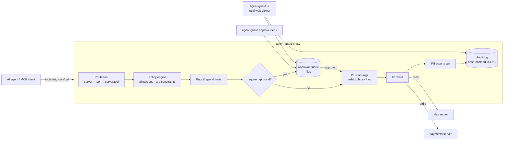

# agent-guard

**A policy-enforcing MCP proxy for AI agents with tool access.** Put agent-guard between your agent and its MCP servers to get allow/deny rules, argument constraints, rate and spend limits, PII redaction, human approval for risky calls, and a tamper-evident audit log. You don't have to change the agent or the servers.

```
agent  ──MCP──▶  agent-guard  ──MCP──▶  your MCP servers (files, payments, db, ...)
                 │ policy · limits · PII · approvals · audit
```

- **One YAML file of rules.** Deny `files.delete_*`, cap `payments.refund` at 500, only allow writes under `notes/`, at most 3 lookups a minute, 1,000 in refunds a day.
- **Denials go back to the agent as ordinary tool errors with a reason**, so the model can explain or change course instead of crashing.
- **PII redaction** (emails, phones, Luhn-checked cards, IBANs, SSNs) in arguments and/or results, per tool: `redact | block | log_only | off`.
- **Human-in-the-loop:** `action: require_approval` holds the call until someone runs `agent-guard approve <id>` or clicks Approve in the local web viewer. If nobody decides before the timeout, the call is denied.
- **Hash-chained JSONL audit log.** `agent-guard verify-log` shows the first entry that was edited, deleted or reordered.
- **Small and local.** Pure Python, built on the official [`mcp` SDK](https://pypi.org/project/mcp/). No database, no daemon, no Node, no Docker.

## Who it's for

People who run AI agents (Claude Desktop, IDE agents, custom agent loops, internal ops bots) that call tools that can **change things**: write files, move money, send email, touch production data. If you've wondered "what stops the agent from refunding 10,000 by mistake, and how would I know afterwards?", this is for you.

## How it works



1. agent-guard is itself an MCP server (stdio). Your client launches `agent-guard run` instead of the real servers.
2. It launches each configured upstream server over stdio, collects their tools and re-exposes them, namespaced by default (`payments__refund`).
3. On every `tools/call` it evaluates the policy. Denials go back to the agent as an error result. Allowed calls get PII handling, are forwarded, the result is scanned, and one audit entry is appended.
4. Approvals are files in `.agent-guard/approvals/`, so the CLI and the web viewer can resolve them from another terminal without any shared server.

## Quickstart (about 2 minutes)

Requires Python 3.10+ and git.

**Windows (PowerShell)**

```powershell
git clone <this-repo-url> agent-guard
cd agent-guard
powershell -ExecutionPolicy Bypass -File scripts\setup.ps1     # venv + install + tests
.\.venv\Scripts\python examples\demo_agent.py                  # scripted demo, no LLM needed
.\.venv\Scripts\agent-guard ui                                 # browse the audit log
```

**macOS / Linux**

```sh
git clone <this-repo-url> agent-guard && cd agent-guard
sh scripts/setup.sh
.venv/bin/python examples/demo_agent.py
.venv/bin/agent-guard ui
```

**Manual setup without the scripts** (any OS):

```sh
python -m venv .venv
# activate it: .venv\Scripts\activate (Windows) or . .venv/bin/activate
pip install -e ".[dev]"
agent-guard validate
pytest -q
```

On a fresh clone (with a warm pip cache), `setup.ps1 -SkipTests` took 27 s and the demo took 7 s on the benchmark machine below. A cold pip cache adds however long your network needs to download the roughly 40 packages it installs, including the test tools.

> Behind a TLS-inspecting corporate proxy, pip may fail with certificate errors. The setup scripts then retry with [`truststore`](https://pypi.org/project/truststore/) (`PIP_USE_FEATURE=truststore`), which uses your OS certificate store. Certificate verification stays on.

### What the demo shows

`examples/demo_agent.py` connects to agent-guard like any MCP client and makes 14 calls against two bundled sample servers (a sandboxed files server and a **fake** payments server):

| Step | Outcome |
|---|---|
| write `notes/todo.md`, read it back | allowed |
| write `../escape.txt` | denied: `path` outside `notes/` |
| `files__delete_file` | denied (and hidden from `tools/list`) |
| write a card number into a file | allowed, but the card is redacted before reaching the server |
| `lookup_customer` | allowed, phone/card/email redacted in the result |
| 4th lookup within a minute | denied: rate limit |
| refund 900 | denied: exceeds max 500 |
| refund to `DROP TABLE` | denied: `customer_id` doesn't match `cus_…` |
| refund 25 | allowed, counts toward a 1,000/day budget |
| refund 250 | **held for approval**; a simulated reviewer approves after 2 s |

Use `--approve manual` to approve it yourself (`agent-guard pending`, then `agent-guard approve <id>`, or the web viewer), or `--approve deny` to watch a rejection.

An optional LLM-driven agent (`examples/llm_agent.py`) talks to any OpenAI-compatible endpoint configured in `.env` (copy `.env.example`; the default is a local Ollama at `http://localhost:11434/v1`). The scripted demo does not need it.

## Use it with your own MCP client

Point your client at agent-guard instead of the upstream servers. Example for a client that uses the common `mcpServers` JSON format:

```json
{
  "mcpServers": {
    "guarded": {
      "command": "C:\\path\\to\\agent-guard\\.venv\\Scripts\\agent-guard.exe",
      "args": ["run", "-c", "C:\\path\\to\\your\\agent-guard.yaml"]
    }
  }
}
```

and list the real servers in `agent-guard.yaml`:

```yaml
agent_id: desktop-assistant     # identity used for rate limits and the audit log
namespace: true                 # expose tools as <server>__<tool>
servers:
  files:
    command: python             # "python" = the interpreter running agent-guard
    args: [examples/servers/files_server.py]
    env: { FILES_SANDBOX: "${CONFIG_DIR}/examples/sandbox" }
  github:
    command: npx                # any stdio MCP server works
    args: ["-y", "@modelcontextprotocol/server-github"]
    env: { GITHUB_PERSONAL_ACCESS_TOKEN: "${GITHUB_TOKEN}" }   # read from your environment
policy: examples/policies/demo.yaml
approvals: { timeout_seconds: 120 }
```

Relative paths resolve against the config file's directory, and upstream servers start with that directory as their working directory. `${VAR}` expands from the environment (`${CONFIG_DIR}` and `${PYTHON}` are built in), so secrets can stay in your environment or `.env` instead of the config.

Useful commands:

| Command | What it does |
|---|---|
| `agent-guard run -c cfg.yaml` | serve the proxy over stdio (what your MCP client launches) |
| `agent-guard validate` | validate config + policy, with precise error locations |
| `agent-guard tools` | start upstreams and list the exposed tools and their policy ids |
| `agent-guard pending` | list calls waiting for approval |
| `agent-guard approve <id> [--note ..]` / `deny <id> [--note ..]` | resolve a pending call |
| `agent-guard log [-n 30]` | print recent audit entries |
| `agent-guard verify-log` | verify the hash chain |
| `agent-guard ui [--port 8765]` | local web viewer: filter calls, approve/deny |

Every command takes `-c/--config`. The default is `$AGENT_GUARD_CONFIG` or `./agent-guard.yaml`.

## Policy reference

A policy is YAML (in its own file, or inline under `policy:` in the config). Tool ids in policies are always **`<server>.<tool>`**, however the tools are exposed to the agent. Run `agent-guard tools` to see them.

```yaml
version: 1
default_action: deny            # allow | deny — used when no rule gives a verdict

rules:
  - name: refund-guardrails     # shown in deny messages and the audit log
    tools: ["payments.refund"]  # glob patterns (fnmatch): *, ?, [abc]
    agents: ["*"]               # glob patterns on the agent id (default "*")
    action: allow               # allow | deny | require_approval | (omit: constraints/limits only)
    when:                       # optional: the rule applies only if ALL conditions hold
      amount: { min: 1 }
    args:                       # constraints: any violation denies the call
      amount:      { required: true, type: number, min: 0.01, max: 500 }
      customer_id: { regex: "cus_[a-z0-9]{3,20}" }      # whole value must match
      currency:    { enum: [USD, EUR] }
      note:        { max_length: 500, not_regex: "(?i)password" }
      path:        { path_under: ["notes", "reports"] }  # lexical, see limitations
      customer.tier: { enum: [gold] }                    # dotted names reach into objects
    rate_limit:  { calls: 20, per_seconds: 3600, scope: tool_agent }
    spend_limit: { cost_arg: amount, budget: 1000, per_seconds: 86400, scope: agent }
    reason: "shown to the agent when this rule denies"
    approval_timeout_seconds: 300   # for require_approval (default: approvals.timeout_seconds)

pii:                            # first matching entry wins
  - tools: ["payments.lookup_customer"]
    detectors: [email, phone, credit_card, iban, ssn]   # default: all
    arguments: "off"            # redact | block | log_only | off  (quote "off" in YAML)
    results: redact
```

**Evaluation order** for each call:

1. A rule *matches* when a `tools` glob matches the tool id, an `agents` glob matches the agent id, and every `when` condition holds. A `when` on a missing argument never matches.
2. **Deny wins:** if any matching rule has `action: deny`, the call is denied.
3. `args` constraints of **all** matching rules are checked. The first violation denies.
4. `rate_limit` / `spend_limit` of all matching rules are checked. Exceeding any of them denies.
5. If any matching rule says `require_approval`, the call waits for a human. Limits are checked again at the moment it's approved.
6. If any matching rule says `allow`, the call is allowed. Otherwise `default_action` applies.

**Constraint keys:** `required`, `type` (`string|number|integer|boolean|array|object`), `min`, `max`, `min_length`, `max_length`, `regex` (full match), `not_regex` (search), `enum`, `path_under`.

**Limits** use in-memory sliding windows. `scope` is `tool_agent` (default for rate), `tool`, `agent` (default for spend) or `global`. Only calls that are actually forwarded count. A spend limit needs `cost_arg` (a non-negative number argument, which fails closed if it's missing or invalid) and/or a fixed `cost_per_call`.

**Validation:** policies are checked with pydantic when they load, and `agent-guard run` refuses to start on an invalid policy. Errors give the exact location and suggest a fix for typos:

```
Invalid policy in policy.yaml:
  - rules.0.rate_limt: unknown key 'rate_limt' (did you mean 'rate_limit'?)
  - rules.1.args.amount: Value error, min (5.0) is greater than max (1.0)
```

**Other config options** (`agent-guard.yaml`): `hide_denied_tools` (default `true`: tools that a deny rule or `default_action: deny` always blocks are left out of `tools/list`), `namespace`, `namespace_separator`, `state_dir`, `audit.{path,enabled,fsync,log_arguments,log_results,result_preview_chars}`, `approvals.{dir,timeout_seconds,poll_interval_seconds}`. The agent id comes from `agent_id`, or from `AGENT_GUARD_AGENT_ID` in the proxy's environment.

### Example policies

| File | Idea |
|---|---|
| [`examples/policies/demo.yaml`](examples/policies/demo.yaml) | what the demo uses: default-deny, path constraint, rate limit, refund max + daily budget + approval over 100, PII rules |
| [`examples/policies/read-only.yaml`](examples/policies/read-only.yaml) | only `read_*`/`list_*`/`get_*`/`search_*`/`lookup_*` tools, PII scrubbed from results |
| [`examples/policies/payments-strict.yaml`](examples/policies/payments-strict.yaml) | layered money-movement guardrails, approval over 200, per-agent budget, deny for `intern-*` agents |
| [`examples/policies/pii-strict.yaml`](examples/policies/pii-strict.yaml) | block any call or result that contains PII, and block SQL DDL in `query` |

## Audit log

Each line of `.agent-guard/audit.jsonl` is one event (`proxy_start`, `approval_requested`, `tool_call`). A `tool_call` entry records: `seq`, `ts`, `call_id`, `agent`, `tool`, `tool_id`, `decision` (`allowed | denied | approved | approval_denied | approval_timeout | error`), `reason`, `rule`, `matched_rules`, `approval_id`, `approved_by`, `pii` findings, `arguments` and `result_preview` (both **PII-masked**, whatever mode the call itself used), `duration_ms`, `upstream_ms`, `prev_hash` and `hash`.

`hash = sha256(canonical JSON of the entry without "hash")`, and `prev_hash` is the previous entry's hash (64 zeros for the first). `agent-guard verify-log` recomputes the chain and names the first entry that was modified, removed, inserted or reordered. `proxy_start` records the `policy_sha256` that was in effect.

## Benchmark: measured latency overhead

`python benchmarks/bench_latency.py -n 500` uses the official MCP client over stdio for every path. The proxied path ran a default-deny policy with allow rules, argument constraints (`max_length`, `not_regex`, `regex`), a rate limit, a spend limit, PII scanning (redact) on arguments and results, and the hash-chained audit log (default settings, no fsync).

**Machine:** Windows 11 Pro (10.0.26300), Intel64 Family 6 Model 140 (GenuineIntel), 16 GB RAM, Python 3.12.10. A normal desktop session, not an isolated benchmark host.
**Date:** 2026-10-09. **N = 500** measured calls per row, after 20 warm-up calls.

| Tool | Path | p50 (ms) | p95 (ms) | p99 (ms) | mean (ms) |
|---|---|---:|---:|---:|---:|
| ping | direct (client → upstream) | 1.08 | 1.38 | 1.58 | 1.12 |
| ping | via agent-guard (client → proxy → upstream) | 3.05 | 3.88 | 4.42 | 3.07 |
| ping | guard pipeline in-process (→ upstream) | 1.57 | 2.36 | 2.72 | 1.65 |
| lookup_customer | direct (client → upstream) | 1.09 | 1.30 | 1.45 | 1.11 |
| lookup_customer | via agent-guard (client → proxy → upstream) | 5.52 | 9.45 | 10.57 | 5.91 |
| lookup_customer | guard pipeline in-process (→ upstream) | 1.53 | 2.15 | 3.04 | 1.62 |

How to read it:

- **Added latency through the proxy** in this run: about **+2.0 ms p50 / +2.5 ms p95** for a tiny echo tool, and **+4.4 ms p50 / +8.2 ms p95** for `lookup_customer`, which returns a larger structured result that gets redacted.
- The **in-process** rows call `GuardedProxy.call_tool` directly. In-process minus direct (about 0.5 ms p50) approximates the guard's own work: policy, limits, PII scanning and the audit write. The rest is the extra stdio/JSON-RPC hop between the client and the proxy.
- Results vary between runs on the same machine. Earlier runs during development (one of them before an audit-writer optimization) measured +1.7 to +3.0 ms p50 for `ping` and +4.4 to +7.8 ms p50 for `lookup_customer`. Why the larger result costs more on the extra hop wasn't profiled further.
- Not measured yet: Linux/macOS, `audit.fsync: true`, large payloads (>100 KB), many concurrent agents. All TBD; measure with `benchmarks/bench_latency.py` (adjust `SCENARIOS`/`POLICY`) on the target machine.

For context, the tool calls agents actually make (network APIs, databases, LLM-backed tools) usually take tens to thousands of milliseconds.

## Security model & limitations

agent-guard is a **policy enforcement point for MCP tool calls**. It is not a sandbox, it doesn't make an untrusted server safe, and it doesn't replace authentication or least-privilege credentials on the upstream systems.

What it does guarantee, when it's the only path to the tools:
- Every `tools/call` is evaluated against the policy before it's forwarded. Evaluation **fails closed**: an internal error, an undeterminable cost, or an approval timeout all deny the call.
- Denied calls never reach the upstream server.
- The audit log records each decision, and edits, deletions or reordering inside the log are detectable.

What it does **not** do (know these before relying on it):
- **Bypass:** if the agent can reach the upstream servers or underlying APIs another way (other MCP entries, shell access, credentials in its environment), agent-guard can't see those calls. Only configure the proxy, and keep the credentials in the proxy's environment.
- **Regex PII detection is best-effort.** It misses names, addresses, dates of birth, free-text identifiers, obfuscated values ("jane at example dot com"), unusual phone formats, SSNs written without dashes, and anything inside images or binary content. It can also over-match long digit runs. Treat it as a safety net, not a compliance control.
- **`path_under` is lexical.** It normalizes `..` and separators but can't see symlinks or the server's real filesystem, and comparison is case-sensitive. The upstream server must still sandbox paths (the bundled files server does).
- **Limits are in-memory, per proxy process.** They reset on restart and aren't shared between proxy instances.
- **Agent identity** is configuration (`agent_id` / `AGENT_GUARD_AGENT_ID`), one per proxy instance. It isn't authenticated, and the agent can't override it per call.
- **Audit log tamper-evidence has limits.** Truncating the newest entries, or rewriting the whole file, can't be detected without an external anchor. `verify-log` prints the head hash; store it somewhere else (CI artifact, ticket, WORM storage) if you need that. The log is not encrypted, so protect the file with OS permissions.
- **Approvals** are files in the state directory. Anyone who can write there can approve. The web viewer binds to 127.0.0.1, requires a per-run token and a matching `Host` header for approvals, and has no login, so don't expose it on a network.
- **MCP surface:** v1 proxies **tools** only (`tools/list`, `tools/call`). Resources, prompts, sampling and upstream `list_changed` notifications aren't forwarded, and the tool list is collected once at startup. Only stdio upstreams are supported.
- **Client timeouts:** some MCP clients time out long requests. A call waiting for approval sends progress notifications when the client asked for them, but a client may still give up before the approval timeout. Set `approvals.timeout_seconds` below your client's request timeout.

If you find a security issue, please report it privately through the repository host's security advisory feature rather than in a public issue.

## Responsible AI notes

- **Keep humans accountable for consequential actions.** Use `require_approval` for anything that moves money, deletes data or contacts people, and give the reviewer the context they need. The approval view shows the tool, the PII-masked arguments and the rule that triggered.
- **Explain refusals to the model.** Deny messages are written for the agent: they say what was denied and why, and (for policy denials) not to retry. This reduces retry loops and lets the agent tell the user what happened.
- **Minimise data exposure.** Redact PII from results the agent doesn't need, and keep it out of logs. The audit log stores PII-masked arguments and results even when a call itself used `log_only`.
- **Be honest about coverage.** Regex PII detection and lexical path checks have known gaps (see above). Don't advertise a deployment as "PII-safe" because of them.
- **Audit for learning, not just blame.** Review denials and approvals regularly; they show where agents misunderstand their tools and where policies are too loose or too strict.
- The sample servers use **synthetic data only**. `4111 1111 1111 1111` and `5555 5555 5555 4444` are public test card numbers.

## How this differs

MCP gateways and proxies are a busy space. Several open-source projects cover parts of the same ground (routing many servers behind one endpoint, authentication, guardrails, audit logging, threat detection), including full gateways and dedicated audit or firewall proxies. Many of them support more transports and integrations than agent-guard does. If you need centralized multi-tenant routing, SSO, or HTTP transports, look at those first. We haven't benchmarked or audited other projects, so we make no claims about how they behave.

agent-guard deliberately aims at a narrower slot:

- **One process, one YAML file, no infrastructure.** It runs where your agent runs, as an ordinary stdio MCP server. There's no database, daemon or container.
- **Per-call semantics rather than per-request plumbing.** Argument constraints, `when` conditions, spend budgets derived from an argument (e.g. `amount`), and deny messages written for the model.
- **Human approval with no extra services.** A file-based queue resolved from the CLI or a localhost page, with fail-closed timeouts.
- **Verifiable from the command line.** A hash-chained log that anyone can check with `agent-guard verify-log`, and a latency benchmark you can rerun.
- **Small enough to read.** About 1,800 lines of Python (plus a ~200-line viewer page), so you can audit the thing you're trusting.

## Roadmap

- [ ] Forward resources and prompts; react to upstream `tools/list_changed`
- [ ] Streamable HTTP upstreams and an HTTP listener for the proxy
- [ ] Persist rate/spend windows (SQLite) so limits survive restarts and can be shared
- [ ] External anchoring of the audit head hash (e.g. periodic signed checkpoints)
- [ ] Pluggable PII detectors (e.g. an optional NER model) alongside the regex set
- [ ] Policy hot-reload and `agent-guard test-policy` for dry-running calls against a policy
- [ ] Notifications for pending approvals (desktop / webhook)

## Contributing

Issues and pull requests are welcome.

```sh
pip install -e ".[dev]"
pytest -q                      # all tests must pass
agent-guard validate           # if you touched config/policies
```

- Conventional commits (`feat:`, `fix:`, `docs:`, `test:`, `perf:`, `chore:`).
- Add tests with every behaviour change. The end-to-end tests launch the real proxy over stdio against `examples/servers/`.
- Never commit secrets, `.env`, audit logs or approval files (they're git-ignored).
- Don't add numbers to the docs that you didn't measure. Write "TBD" and say how to measure it.

## License

[MIT](LICENSE)
